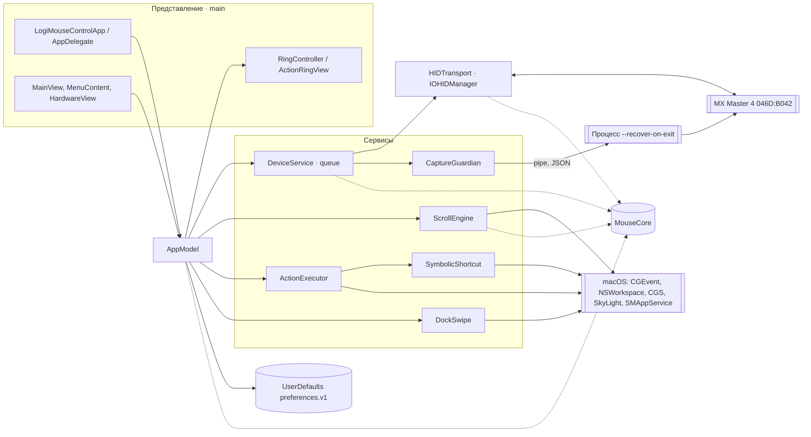
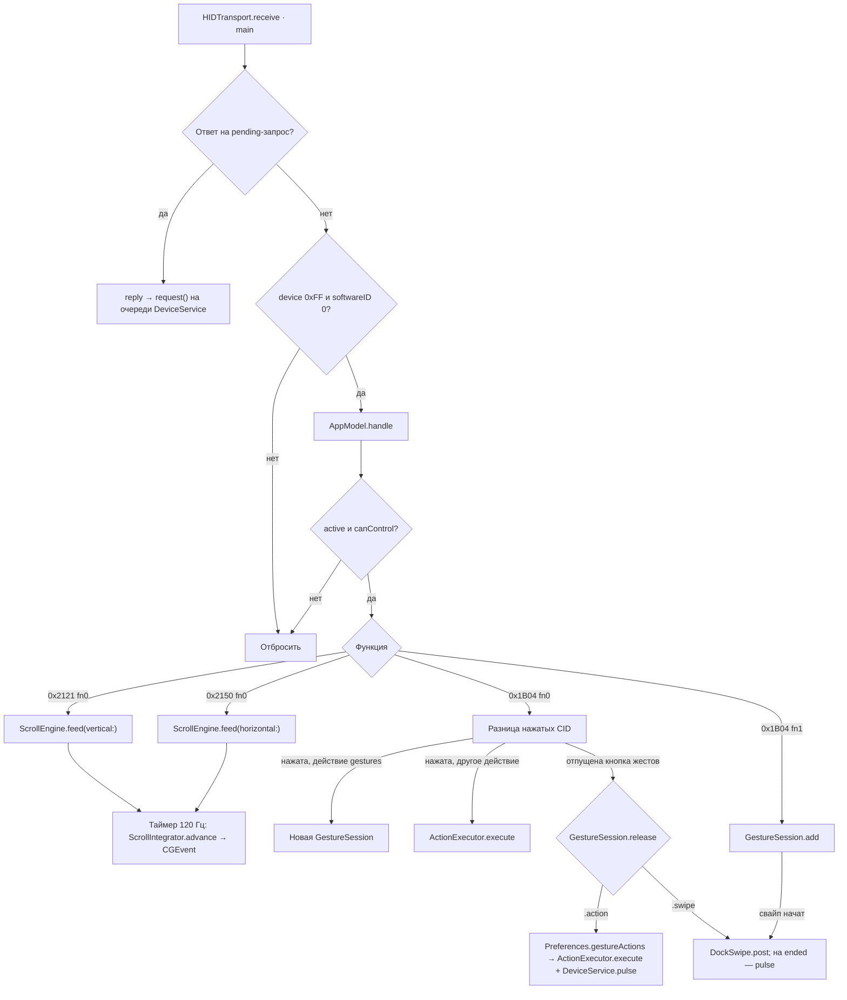
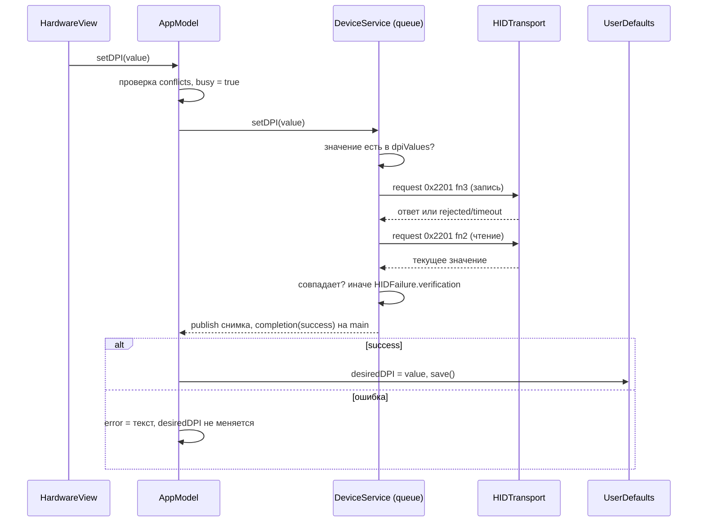
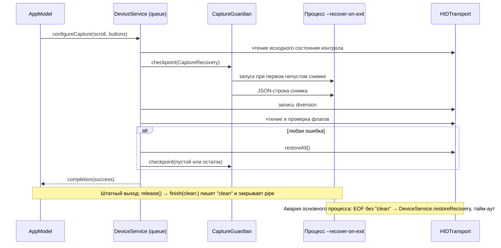
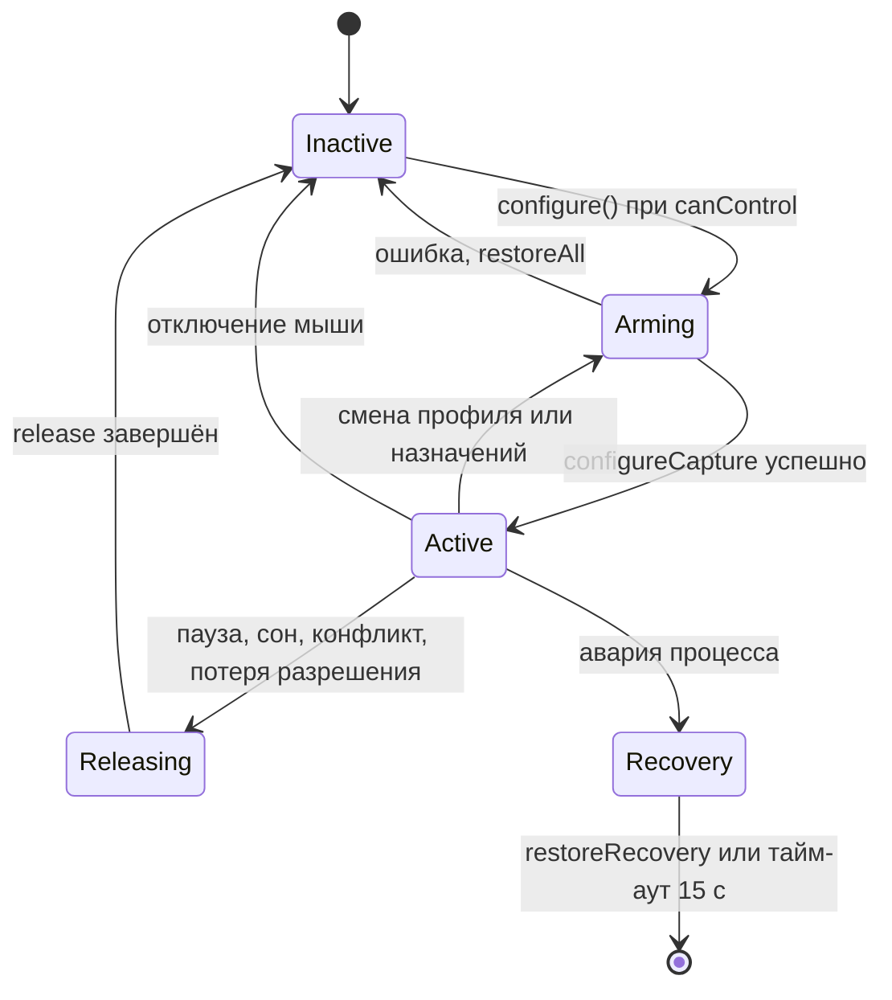

# Архитектурная конституция LogiMouseControl

Версия: 2.1.0
Дата: 2026-10-12
Статус: действующая
Последнее изменение: [CH-0003](changes/0003-smooth-desktop-swipe/spec.md) — плавное переключение рабочих столов (`DockSwipe`, `SpaceSwipe`, `GestureSession`, [ADR-0002](adr/0002-dock-swipe-synthesis.md)). Сверка с кодом: CH-0001, коммит `ef48295`, и затронутые CH-0002 и CH-0003 разделы.

Документ описывает приложение таким, какое оно есть в коде. Процесс работы с изменениями описан в [README.md](README.md), термины — в [ontology.md](ontology.md).

## Как читать документ

| Раздел | Что в нём |
|---|---|
| Разделы 1–9 и «Конкурентность и жизненный цикл» (подразделы 5.1–5.2) | **Факт**: реализовано в коде. Утверждения ссылаются на файл и символ. |
| «Неприкосновенные правила» | **Ограничение**: обязательно для любого изменения. Идентификаторы INV-… используются в спецификациях. |
| «Расхождения» | Противоречия между прежней документацией и кодом, найденные при сверке. |
| «Неизвестное и непроверенное» | То, что не подтверждено кодом, проверкой или источником. |
| «Предлагаемые улучшения» | **Предложение**: не реализовано, требует собственной спецификации. |

Пути к исходникам ниже даны относительно корня репозитория. Номера строк не указываются: они устаревают быстрее символов.

## 1. Назначение и границы

LogiMouseControl — локальное приложение для macOS 14+, управляющее Logitech MX Master 4 по Bluetooth через HID++. Нет аккаунтов, сетевого клиента, телеметрии, автообновления и сторонних зависимостей (`Package.swift` не объявляет `dependencies`).

Реализовано в коде:

- подключение только к `046D:B042` (`HIDTransport.start()`), чтение функций и кнопок (`DeviceService.refresh(discover:)`);
- собственная плавная прокрутка вертикального и бокового колёс (`ScrollEngine`, `ScrollIntegrator`);
- DPI, SmartShift/ratchet/free-spin, порог и сила отсечек, виброотклик (`DeviceService.setDPI`, `setWheel`, `setHaptics`, `pulse`);
- назначение действий кнопкам, жесты с действием для каждого направления, переключение рабочих столов (на macOS 27+ плавное, вслед за мышью), кольцо действий из шести пунктов, запуск приложений из кольца (`AppModel.handle(_:)`, `ActionExecutor`, `RingController`);
- профили приложений для прокрутки и кнопок по bundle identifier (`AppModel.effectiveScroll`, `effectiveButtons`);
- Easy-Switch, заряд, запуск при входе (`DeviceService.switchHost`, `AppModel.setLogin`);
- аварийное восстановление через дочерний процесс (`CaptureGuardian`);
- служебные режимы `--diagnose`, `--render-artwork-preview <папка>`, `--recover-on-exit` (`AppEntry.main()`).

Не поддерживается: Bolt, другие модели, назначение левой и правой кнопок, Flow, Smart Actions, обновление прошивки, профили DPI и кольца для отдельных приложений. Полный перечень — `README.md`, разделы «Реализовано» и «Пока не реализовано».

Ни одна аппаратная функция не подтверждена на физической мыши: все пункты `docs/HARDWARE_VALIDATION.md` открыты.

## 2. Сборка из targets

| Target | Тип | Путь | Зависит от | Назначение |
|---|---|---|---|---|
| `MouseCore` | library | `Sources/MouseCore` | только `Foundation` | HID++-пакеты, настройки и действия, интегратор прокрутки, накопитель жестов, математика свайпа рабочих столов, каталог изображений |
| `LogiMouseControl` | executable | `Sources/LogiMouseControl` | `MouseCore`; AppKit, IOKit, ApplicationServices, ServiceManagement; ресурсы `DeviceImages` | приложение, помощник восстановления, диагностика |
| `MouseCoreChecks` | executable | `Tests/MouseCoreTests` | `MouseCore` | 27 самописных проверок ядра без XCTest |
| `SymbolicShortcutChecks` | не SwiftPM | `Tests/SymbolicShortcutChecks` | исходник `SymbolicShortcut.swift` | 13 проверок с подставными зависимостями; собирается `swiftc` в `scripts/test.sh` |

Следствие для кода: `Sources/LogiMouseControl/SymbolicShortcut.swift` компилируется отдельно от остального target, поэтому может зависеть только от `AppKit` и `Darwin`, но не от `MouseCore` и других файлов приложения.

## 3. Компоненты

| Компонент | Файл | Ответственность | Использует | Поток |
|---|---|---|---|---|
| `AppEntry` | [AppEntry.swift](../../Sources/LogiMouseControl/AppEntry.swift) | Разбор флагов запуска, `diagnose()` | `DeviceService`, `CaptureGuardian.run()`, `LogiMouseControlApp` | main |
| `LogiMouseControlApp`, `AppDelegate` | [LogiMouseControlApp.swift](../../Sources/LogiMouseControl/LogiMouseControlApp.swift) | Окно, строка меню, политика активации, штатное завершение | `AppModel` | main |
| Views | [MainView.swift](../../Sources/LogiMouseControl/MainView.swift), [MouseIllustration.swift](../../Sources/LogiMouseControl/MouseIllustration.swift), [RingActionIcon.swift](../../Sources/LogiMouseControl/RingActionIcon.swift), [ArtworkPreview.swift](../../Sources/LogiMouseControl/ArtworkPreview.swift) | Отображение и ввод настроек | только `AppModel` и типы `MouseCore` | main |
| `AppModel` | [AppModel.swift](../../Sources/LogiMouseControl/AppModel.swift) | Состояние для UI, разрешения, конфликты, профили, захват, жизненный цикл, разбор событий устройства | все сервисы, `UserDefaults`, `NSWorkspace`, `SMAppService` | main (по соглашению) |
| `DeviceService` | [DeviceService.swift](../../Sources/LogiMouseControl/DeviceService.swift) | Команды HID++, снимок устройства, запись с проверкой, захват и освобождение контролов | `HIDTransport`, `CaptureGuardian` | очередь `local.logimouse.hardware` |
| `HIDTransport` | [HIDTransport.swift](../../Sources/LogiMouseControl/HIDTransport.swift) | IOHIDManager, открытие устройства, один запрос в полёте, доставка событий | IOKit, `HIDPacket` | callbacks на main run loop; `request` на очереди |
| `CaptureGuardian` | [CaptureGuardian.swift](../../Sources/LogiMouseControl/CaptureGuardian.swift) | Дочерний процесс `--recover-on-exit` и pipe со снимком восстановления | `Process`, `Pipe`, `DeviceService` (в дочернем процессе) | очередь `DeviceService` |
| `ScrollEngine` | [ScrollEngine.swift](../../Sources/LogiMouseControl/ScrollEngine.swift) | Пиксельные `CGEvent` прокрутки, таймер 120 Гц, прерывание чужим вводом | `ScrollIntegrator` | main |
| `ActionExecutor` | [ActionExecutor.swift](../../Sources/LogiMouseControl/ActionExecutor.swift) | Сочетания клавиш, медиаклавиши, системные приложения, системные сочетания (Spotlight, окна приложения, рабочий стол, рабочие столы слева/справа) | `SymbolicShortcut`, `NSWorkspace`, `CGEvent` | main |
| `SymbolicShortcut` | [SymbolicShortcut.swift](../../Sources/LogiMouseControl/SymbolicShortcut.swift) | Один symbolic hotkey WindowServer (64, 33, 36, 79, 81) через динамически загружаемый CGS: чтение действующего сочетания, запасное значение macOS по умолчанию, временное включение и возврат | `dlopen`/`dlsym` | main |
| `DockSwipe` | [DockSwipe.swift](../../Sources/LogiMouseControl/DockSwipe.swift) | События DockSwipe для плавного перехода между рабочими столами на macOS 27+: `IOHIDEvent`, вложенный в `CGEvent` типа 30 (ADR-0002) | `dlopen`/`dlsym` (IOKit, SkyLight), `CGEvent` | main |
| `RingController` | [RingController.swift](../../Sources/LogiMouseControl/RingController.swift) | Неактивирующая `NSPanel` с `ActionRingView` | SwiftUI, `NSEvent` monitors | main |
| `MouseCore` | [Sources/MouseCore](../../Sources/MouseCore/) | `HIDPacket`, `HIDFailure`, `reportingPayload`, `WheelMode`, `Preferences`, `ScrollIntegrator`, `GestureAccumulator`, `GestureDirection`, `GestureActions`, `GestureSession`, `SpaceSwipe`, `SwipeStep`, `MouseIdentity`, `MouseArtworkManifest` | `Foundation` | любой |

Views меняют `AppModel.preferences` через привязки и вызывают методы `AppModel`; к `DeviceService`, `HIDTransport` и `ActionExecutor` они не обращаются. Исключение — `ArtworkPreview.renderArtworkPreview(to:)`: он создаёт `ButtonAssignmentsView` с фиктивными данными без `AppModel`.

## 4. Потоки данных

### 4.1. Подключение и снимок устройства

1. `HIDTransport.start()` создаёт `IOHIDManager` с фильтром VID/PID и планирует его на main run loop. `attach(_:)` открывает устройство без захвата (`kIOHIDOptionsTypeNone`) и вызывает `onConnect`.
2. `DeviceService.refresh(discover: true)` на очереди запрашивает индексы функций `0x0003, 0x2201, 0x2111, 0x2110, 0x2121, 0x2150, 0x1004, 0x19B0, 0x1B04, 0x1814` у корневой функции, перечисляет контролы `0x1B04` (не больше 64; в список попадают контролы с флагом `0x20` и без флага `0x80`), читает множитель колеса, разрешение бокового колеса и список DPI (`parseDPI`).
3. Необязательные чтения (цвет, DPI, режим колеса, виброотклик, батарея, Easy-Switch) идут через `readOptional`: ошибка одного чтения добавляется в `DeviceSnapshot.warnings`, а не прерывает обновление.
4. `publish()` отправляет копию `DeviceSnapshot` на main в `AppModel.device`. После успешного обнаружения вызывается `onConnected` → `AppModel.didConnect()`.
5. `didConnect()` при первом подключении в сеансе и пустых `preferences.buttons` назначает действия по умолчанию известным CID, затем при отсутствии конфликтов повторно применяет сохранённые `desiredDPI`, `desiredWheel`, `desiredHaptics` и вызывает `configure()`.

### 4.2. Событие устройства → прокрутка или действие

`HIDTransport.receive(_:)` на main сначала сопоставляет пакет с ожидающим запросом (`HIDPacket.response(to:)`). Пакет без совпадения с `device == 0xFF` и `softwareID == 0` считается событием и передаётся через `DeviceService.onEvent` в `AppModel.handle(_:)`. События обрабатываются, только если `active && canControl`.

- Вертикальное смещение: `signedWord(payload, 1)`, делённое на `verticalMultiplier` в режиме высокого разрешения, ×40. Боковое: `signedWord(payload) / horizontalResolution × 800`. Происхождение коэффициентов 40 и 800 в репозитории не описано (U-08).
- `ScrollEngine.feed` учитывает скорость и направление из `ScrollPreferences`, запускает `DispatchSourceTimer` на main с периодом 1/120 с и останавливает его через 0,09 с без ввода. События помечаются `eventSourceUserData = ScrollEngine.marker`; глобальный монитор нажатий и чужой точной прокрутки вызывает `stop()`.
- Действие берётся из `AppModel.eventButtons` — копии назначений, подтверждённых последним успешным `configureCapture`. Нажатие любой кнопки останавливает инерцию прокрутки.
- Для тактильной панели (`0x1A0`) первый сдвиг Raw XY отбрасывается (`GestureAccumulator(discardFirst:)`). Порог жеста — 60 единиц; меньший сдвиг — направление `click`. При отпускании `AppModel` берёт действие из `Preferences.gestureActions(for: CID)[direction]` (общие для всех профилей), выполняет его через `ActionExecutor.execute` и, кроме «Ничего», вызывает `pulse()`. Последний жест хранится в `AppModel.lastGesture` только в памяти.
- Плавный свайп рабочих столов (CH-0003). `GestureSession` получает знак свайпа, только если `DockSwipe.isAvailable` (macOS 27+ и найдены функции IOKit/SkyLight) и «влево/вправо» этой кнопки — пара «Рабочий стол слева/справа» (`GestureActions.desktopSwipeSign`: +1 или −1 для зеркальной пары). Если первым порог 60 проходит горизонтальный сдвиг, `SpaceSwipe` выдаёт began и затем changed с накопленным прогрессом в рабочих столах (800 единиц Raw XY на стол при 1000 DPI, пропорционально `DeviceSnapshot.dpi`). На каждом целом столе — ended с прогрессом ±1 и began с остатком, поэтому одно движение проходит несколько столов. Отпускание даёт ended со сглаженной скоростью (столов в секунду; 0 после 0,15 с покоя) или cancelled при рывке назад; дискретное действие тогда не выполняется. Если первым порог прошёл вертикальный сдвиг, сессия работает как раньше. Свайп ведёт только одна сессия одновременно. `DockSwipe.post` на began читает `com.apple.swipescrolldirection` и при естественной прокрутке меняет знак прогресса и скорости HID, отправляет `CGEvent` типа 30 с маркером `ScrollEngine.marker` в `.cgSessionEventTap`. Каждое ended сопровождается `pulse()`.
- Системные действия «Окна приложения», «Показать рабочий стол», «Рабочий стол слева/справа» и Spotlight отправляют сочетание, которое сообщает WindowServer (`CGSGetSymbolicHotKeyValue`), через `.hidSystemState` в `.cgSessionEventTap`. Файл `com.apple.symbolichotkeys` не читается: в нём может не быть неизменённых значений по умолчанию. Если CGS не вернул сочетание, используется значение macOS по умолчанию с флагом Fn (`0x840000` для стрелок). Mission Control открывается через `NSWorkspace`.

### 4.3. Изменение аппаратной настройки

`setWheel` и `setHaptics` устроены так же: запись, повторное чтение (`readWheel`, `readHaptics`), сравнение. `pulse` и `switchHost` не являются настройками и не проверяются чтением: `switchHost` использует `HIDTransport.notify`, потому что мышь уходит на другой канал без ответа.

### 4.4. Захват контролов и аварийное восстановление

`AppModel.configure()` решает, включать захват или освобождать контролы. Захват включается только при `canControl` (подключено, есть оба разрешения, нет конфликтов, нет паузы, сна и завершения).

- Порядок для каждого контрола: прочитать исходное состояние один раз (`originalWheel`, `originalThumb`, `originalButtons`) → `checkpoint()` → запись → чтение и сравнение флагов.
- Колесо: `0x2121 fn2 [3, 0, 0]`, проверка `fn1[0] & 3 == 3`. Боковое колесо: `0x2150 fn2 [1, 0, 0]`. Кнопки: `0x1B04 fn3` с `reportingPayload(…, diverted: true, rawXY:)`; Raw XY включается только для действия «Жесты» и контролов с флагом `0x100`.
- Действие `.system` возвращает контрол в native HID; действие `.none` («Ничего») оставляет контрол перехваченным и ничего не выполняет.
- Освобождение (`restoreScroll`, `restoreButton`, `restoreAll`) записывает исходное состояние со сброшенным битом diversion и не перечитывает его (D-02).
- Снимок `CaptureRecovery` передаётся только через pipe; помощник держит последний снимок в памяти. `checkpoint()` бросает `HIDFailure.safetyUnavailable`, если помощник не запущен или завершился; сторож `AppModel.watchdog()` каждые 2 с вызывает `checkCaptureSafety` и при ошибке ставит паузу.

### 4.5. Настройки

1. `AppModel.init()` читает `UserDefaults.standard.data(forKey: "preferences.v1")`, декодирует `Preferences` и вызывает `sanitize()`.
2. Привязки views меняют `AppModel.preferences`. Прокрутка, кнопки, направления жестов и профили вызывают `preferencesChanged()` = `save()` + `configure()`. Изменение кольца вызывает только `save()`.
3. Аппаратные значения в `HardwareView` хранятся в локальных `@ViewState` и попадают в `Preferences` только после подтверждения устройством (4.3).
4. При смене активного приложения (`NSWorkspace.didActivateApplicationNotification`, кроме собственного bundle) `frontmostID` меняется, прокрутка и кольцо останавливаются, `configure()` применяет эффективный профиль.

## Конкурентность и жизненный цикл

### 5.1. Потоки и владение изменяемым состоянием

| Состояние | Владелец | Где меняется | Синхронизация |
|---|---|---|---|
| `@Published`-поля и приватное состояние `AppModel` (`held`, `gestureState`, `captureBusy`, `captureDirty`, `eventButtons`, `appliedScroll`, `appliedButtons`, `frontmostID`) | `AppModel` | main | соглашение: все callbacks сервисов приходят на main; `@MainActor` не объявлен |
| `snapshot`, `originalWheel`, `originalThumb`, `originalButtons`, `captured` | `DeviceService` | очередь `local.logimouse.hardware` | последовательная очередь; на main уходят копии через `publish()` |
| `pending`, `reply`, `softwareID`, `device` | `HIDTransport` | очередь (запрос) и main (ответ, подключение) | `NSCondition`; `device` читается без блокировки в `retry()` и `attach(_:)` на main |
| `IOHIDManager`, callbacks устройства | `HIDTransport` | main run loop | `dispatchPrecondition(.onQueue(.main))` в `start()` |
| `process`, `input` | `CaptureGuardian` | очередь `DeviceService` | вызывается только из `DeviceService.checkpoint()` и `finishGuardian` |
| Интеграторы, таймер, монитор событий | `ScrollEngine` | main | таймер на `.main` |
| `lastGesture` | `AppModel` | main | только в памяти |
| `gestureState` (`GestureSession` со `SpaceSwipe`) | `AppModel` | main | сбрасывается через `cancelGestures()`, который отправляет cancelled начатому свайпу |
| `hidSign` (знак HID на сегмент) | `DockSwipe` | main | — |
| `needsRestore`, `generation` (у каждого экземпляра) | `SymbolicShortcut` | main | восстановление планируется через `DispatchQueue.main.asyncAfter` |
| Панель и мониторы | `RingController` | main | — |

Правила, которые соблюдает код: `HIDTransport.request` содержит `precondition(!Thread.isMainThread)`; ожидание ответа ограничено 0,8 с; одновременно ожидается один запрос, потому что все запросы идут через `DeviceService.perform` на последовательной очереди; `completion` и `onError` вызываются на main.

### 5.2. Жизненный цикл

| Событие | Обработчик | Результат |
|---|---|---|
| Запуск | `AppEntry.main()` → `LogiMouseControlApp` → `AppModel.init()` | Чтение настроек, подписка на `NSWorkspace`, `transport.start()`, сторож каждые 2 с |
| Появление окна | `MainWindowContent.onAppear` | `delegate.model = model`, политика активации `.regular` |
| Закрытие окна | `MainWindowCloseObserver.windowWillClose` | Политика `.accessory`; обработка продолжается, приложение остаётся в строке меню (`LSUIElement`) |
| Пауза | `AppModel.togglePause()`, `pause()` | `configure()` → `cancelGestures()` и `release`; пауза не сохраняется между запусками |
| Автоматическая пауза | `ScrollEngine.onFailure` (пропал Универсальный доступ), сторож (помощник недоступен) | `pause()` |
| Сон, выход из сеанса | `willSleepNotification`, `sessionDidResignActiveNotification` | `sleeping = true`, остановка прокрутки и кольца, `configure()` → `cancelGestures()` и `release` |
| Пробуждение, возврат в сеанс | `didWakeNotification`, `sessionDidBecomeActiveNotification` | Через 1 с `refresh()` и `configure()` |
| Отключение мыши | `HIDTransport.removed` → `DeviceService.onDisconnected` | `AppModel` сбрасывает `active`, захват и прокрутку, отменяет начатый свайп; `DeviceService` забывает исходные состояния и отправляет помощнику пустой снимок |
| Переподключение | Сторож: `transport.retry()` → `attach` → `refresh(discover: true)` → `didConnect()` | Повтор сохранённых аппаратных настроек и захвата |
| Смена активного приложения | `didActivateApplicationNotification` | Новый профиль через `configure()`. Если захват не меняется, `held` и жесты сохраняются (переход между рабочими столами сам активирует другие приложения); иначе начатый свайп отменяется |
| Изменение разрешений или конфликтов | Сторож сравнивает с прошлым значением | `configure()` |
| Easy-Switch | `AppModel.switchHost` → `DeviceService.switchHost` | `restoreAll()`, затем `notify` 0x1814 |
| Выход | `AppDelegate.applicationShouldTerminate` → `AppModel.shutdown` | Остановка всего, `cancelGestures()`, `cancelPendingActions()` (возврат всех временно включённых системных сочетаний), `release`, `finishGuardian(clean: success)`, `transport.stop()`; ответ `.terminateLater` |
| Авария основного процесса | EOF в pipe помощника без `clean` | `CaptureGuardian.run()` ждёт подключения до 15 с и вызывает `restoreRecovery` |

`captureBusy` и `captureDirty` сериализуют `configure()`: повторный вызов во время операции откладывается и выполняется после её завершения.

## 6. Разрешения, конфликты и ошибки

| Условие | Как определяется | Что блокирует |
|---|---|---|
| Универсальный доступ | `AXIsProcessTrusted()` | `canControl`, `ScrollEngine.feed`/`tick`, `ActionExecutor.execute`, `showRing` |
| Мониторинг ввода | `CGPreflightListenEventAccess()` | `canControl`; без него `IOHIDManagerOpen`/`IOHIDDeviceOpen` возвращают ошибку |
| Конфликт | `AppModel.updatePermissions()`: bundle ID `com.nuebling.mac-mouse-fix.helper`, `org.openlogi.agent`, `org.openlogi.overlay`, префиксы `com.logi.optionsplus`, `com.logitech.logioptions`, имя «logi options+» | `canControl`, `setDPI`, `setWheel`, `setHaptics`, повтор настроек в `didConnect`; кнопки Easy-Switch отключены в UI |

`Info.plist` содержит `NSInputMonitoringUsageDescription` и `NSBluetoothAlwaysUsageDescription`.

Ошибки:

| Источник | Путь | Где видит пользователь |
|---|---|---|
| `HIDFailure` из команд | `DeviceService.perform` → `onError` → `AppModel.error` | Карточка «Нужна проверка» в `MainView`, только если есть Мониторинг ввода |
| Необязательные чтения | `readOptional` → `DeviceSnapshot.warnings` | Страница «Приложение» |
| Действия | `ActionExecutor.onError`, `SymbolicShortcut` | `AppModel.error` |
| Сохранение настроек, запуск при входе | `AppModel.save()`, `setLogin` | `AppModel.error` |
| Чтение настроек | `try?` в `AppModel.init()` | Не показывается: настройки молча заменяются значениями по умолчанию (см. раздел 8) |
| Ошибка открытия HID | `HIDTransport.onStatus` | `AppModel.error` с текстом `HIDFailure.io` про Мониторинг ввода для любого кода IOReturn (D-04) |

## 7. Желаемое, сохранённое и подтверждённое состояние

| Вид | Аппаратные настройки (DPI, колесо, виброотклик) | Захват (прокрутка, кнопки) |
|---|---|---|
| Желаемое | Локальные `@ViewState` в `HardwareView` до нажатия «Применить» | `Preferences.scroll.enabled`, `Preferences.buttons`, профили; сохраняются сразу |
| Сохранённое | `Preferences.desiredDPI`, `desiredWheel`, `desiredThreshold`, `desiredTorque`, `desiredHaptics`, `desiredIntensity`; пишутся только после подтверждения | те же поля `Preferences` |
| Подтверждённое | `DeviceSnapshot` после чтения с устройства | `AppModel.appliedScroll`, `appliedButtons`, `eventButtons` после успешного `configureCapture`; признак `active` |

Сохранённые аппаратные настройки повторяются при каждом подключении. Если повтор не удался, они остаются сохранёнными, а пользователь видит ошибку. UI показывает текущие значения из `DeviceSnapshot`, а не из `Preferences`.

## 8. Формат настроек и совместимость

Ключ `preferences.v1` в `UserDefaults.standard`; значение — `Data` от `JSONEncoder` для `Preferences` (`Sources/MouseCore/Preferences.swift`). В собранном `.app` домен — `local.alexandr.LogiMouseControl`.

| Тип | Поля | Особенности |
|---|---|---|
| `Preferences` | `scroll`, `buttons`, `gestures`, `ring`, `profiles`, `desiredDPI?`, `desiredWheel?`, `desiredThreshold`, `desiredTorque?`, `desiredHaptics?`, `desiredIntensity` | Ключи `buttons` и `gestures` — десятичный CID строкой (`"416"` для `0x1A0`). Ручной `init(from:)` (CH-0002): отсутствующий ключ даёт значение по умолчанию |
| `ScrollPreferences` | `enabled`, `smooth`, `natural`, `horizontalNatural`, `speed`, `horizontalSpeed`, `smoothness` | `sanitize()` ограничивает скорости 0,2…4 и `smoothness` 0,015…0,18 |
| `AppProfile` | `id` (bundle identifier), `name`, `scroll`, `buttons` | — |
| `RingAction` | строка `MouseAction` или `{"application": RingApplication}` | Собственный `Codable`; старый формат-строка читается |
| `RingApplication` | `bundleIdentifier?`, `name`, `path` | Поиск по bundle ID, затем по пути (`resolvedURL`) |
| `GestureActions` | `up`, `down`, `left`, `right`, `click` | Ручной `init(from:)`: отсутствующее или неизвестное значение направления заменяется значением по умолчанию; `.system` и `.gestures` недопустимы |
| `MouseAction`, `WheelMode` | строковые `rawValue` | CH-0002 добавил `previousDesktop`, `nextDesktop` |

`sanitize()` вызывается при чтении и каждом сохранении: ограничивает диапазоны, округляет `desiredDPI` до 50 в пределах 200…8000 и восстанавливает кольцо по умолчанию, если в нём не 6 допустимых пунктов.

Поведение синтезированного `Codable` (проверено на Swift 6.4 в CH-0001; с CH-0002 у `Preferences` ручной декодер, у `ScrollPreferences` и `AppProfile` по-прежнему синтезированный): отсутствие ключа у необязательного поля даёт `nil`; отсутствие ключа у неопционального поля, даже со значением по умолчанию, и неизвестное значение перечисления дают ошибку декодирования всего `Preferences`. `AppModel.init()` в этом случае использует `Preferences()`, а следующий `save()` перезаписывает прежние данные. Поэтому действует INV-14.

## 9. Сборка, подпись и идентичность

- `scripts/test.sh`: `swift run MouseCoreChecks`, затем `swiftc` собирает и запускает `SymbolicShortcutChecks`. Кэши модулей — в `.build`.
- `scripts/build.sh [release|debug]`: ищет подпись `Logi Mouse Control Local Signing` (или `LOGI_MOUSE_CONTROL_SIGNING_IDENTITY`: имя или SHA-1); без неё завершается с ошибкой. Собирает продукт, создаёт `dist/Logi Mouse Control.app`, копирует `Info.plist`, `THIRD_PARTY_NOTICES.md`, `AppIcon.icns` и `LogiMouseControl_LogiMouseControl.bundle`, подписывает с `--identifier local.alexandr.LogiMouseControl`, проверяет `codesign --verify --strict` и отказывается от ad hoc-подписи (требование `cdhash H"…"`).
- `scripts/setup-local-signing.sh` один раз создаёт самоподписанный сертификат в пользовательской связке ключей и доверие для подписи кода. Скрипт меняет связку ключей; агенты его не запускают.
- Идентичность для macOS: bundle ID и идентификатор подписи `local.alexandr.LogiMouseControl` плюс постоянный сертификат. Их смена заставит заново выдавать Мониторинг ввода и Универсальный доступ (`README.md`, раздел «Запуск»).
- Без скопированного ресурсного bundle сгенерированный SwiftPM-доступ `Bundle.module` завершает процесс через `fatalError` при первом обращении к изображениям (`MouseArtwork` в `MouseIllustration.swift`); проверено по сгенерированному `resource_bundle_accessor.swift`.
- Приложение не нотаризовано, hardened runtime и entitlements не используются.
- `Info.plist`: версия `0.1.0` (сборка `1`), `LSMinimumSystemVersion` 14.0, `LSUIElement`.

## Неприкосновенные правила

Нарушение любого правила требует полной спецификации и ADR. Ссылайтесь на правила по идентификатору.

1. **INV-1.** Агенты не проверяют физические нажатия, прокрутку и назначенные действия, не имитируют их и не запускают действия, в том числе кнопкой «Проверить действие» (`AppModel.testAction`). Это делает пользователь.
2. **INV-2.** Автоматическая проверка использует только сборку, статические проверки, чистую логику и подставные зависимости, которые не генерируют ввод, не запускают приложения и не меняют системные настройки. Успешная сборка не подтверждает работу аппаратной функции.
3. **INV-3.** Не сохранять серийный номер, Bluetooth-адрес, историю нажатий, перемещений и активных приложений. `MouseIdentity.extendedModelID` оставляет из ответа `0x0003` один байт.
4. **INV-4.** Не добавлять сеть, телеметрию, аналитику, автообновление, облачную синхронизацию и сторонние зависимости без ADR.
5. **INV-5.** Аппаратная настройка сохраняется как применённая только после записи, повторного чтения и совпадения значения; иначе `HIDFailure.verification`. Захват считается активным только после проверки флагов чтением. Исключения, существующие в коде: освобождение контролов, `pulse`, `switchHost` (D-02).
6. **INV-6.** Перед каждой записью, включающей diversion, вызывается `DeviceService.checkpoint()`, и помощник получает актуальный снимок.
7. **INV-7.** Захват включается только при `canControl`: устройство подключено, оба разрешения есть, конфликтов нет, нет паузы, сна и завершения. Аппаратные настройки не пишутся при конфликте.
8. **INV-8.** Совместимость с macOS 14+ и Swift tools 5.9; `MouseCore` импортирует только `Foundation`.
9. **INV-9.** UI не показывает нереализованную функцию работающей и показывает только контролы и функции, сообщённые устройством.
10. **INV-10.** Открывается только `046D:B042`, без захвата устройства (seize): стандартный HID-ввод остаётся системе.
11. **INV-11.** Одновременно один HID++-запрос; ответ сопоставляется строго через `HIDPacket.response(to:)`; ожидание ограничено; `request` не вызывается с main thread.
12. **INV-12.** В контрол пишутся только флаги, разрешённые его таблицей возможностей; analytics не включается, постоянная diversion сбрасывается (`reportingPayload`).
13. **INV-13.** Снимок восстановления существует только в памяти и в pipe помощника; не пишется на диск и в журналы.
14. **INV-14.** Данные `preferences.v1`, сохранённые предыдущей версией, читаются новой без потери настроек. Новые поля — необязательные или с ручным `init(from:)` через `decodeIfPresent`; ключи и значения перечислений не переименовываются и не удаляются. Несовместимое изменение — только через новый ключ, миграцию, полную спецификацию и ADR.
15. **INV-15.** Bundle ID, идентификатор подписи и сертификат не меняются без ADR: смена сбрасывает разрешения macOS у пользователя.
16. **INV-16.** Пауза, сон, выход из сеанса, отключение мыши и выход из приложения останавливают прокрутку, закрывают кольцо, завершают начатый свайп рабочих столов фазой cancelled (ADR-0002) и освобождают контролы; при аварии контролы восстанавливает помощник.

## Проверки качества

| Проверка | Что подтверждает | Что не подтверждает |
|---|---|---|
| `./scripts/test.sh` | Логику `MouseCore` (27 проверок) и `SymbolicShortcut` на подставных зависимостях (13 проверок) | Работу с устройством, `AppModel`, `DeviceService`, UI |
| Отладочная сборка `swift build --product LogiMouseControl` (команда в `.claude/skills/verify/SKILL.md`) | Компиляцию приложения, без изменения `dist/` и подписи | Поведение |
| `./scripts/build.sh` | Сборку `.app`, подпись постоянным сертификатом | Поведение; перезаписывает `dist/` |
| `--render-artwork-preview <папка>` | Вёрстку `ButtonAssignmentsView` и `MouseIllustration` | Нажатия и реакцию мыши |
| `--diagnose` | Чтение функций и настроек с подключённой мыши, только чтение | Захват, прокрутку, действия |
| `git diff --check` | Формат патча | — |
| Ручная проверка пользователем по `docs/HARDWARE_VALIDATION.md` | Аппаратное поведение | — |

## Расхождения

Найдены при сверке документации с кодом в CH-0001. Исправлены в документации; код не менялся.

| ID | Было в документации | Факт в коде | Решение |
|---|---|---|---|
| D-01 | «Два Swift Package Manager targets» | `Package.swift` объявляет три target, включая `MouseCoreChecks`; `SpotlightShortcutChecks` (с CH-0002 — `SymbolicShortcutChecks`) собирается вне SwiftPM | Раздел 2 |
| D-02 | «Аппаратная запись считается успешной только после ответа и проверки состояния»; в README — «чтение после записи» | `restoreScroll`, `restoreButton`, `restoreRecovery` не перечитывают состояние; `switchHost` использует `notify` без ответа | INV-5 перечисляет исключения; P-02 |
| D-03 | «Applied configuration» как одна сущность | Разделено: `DeviceSnapshot` для аппаратных настроек, `appliedScroll`/`appliedButtons`/`eventButtons` для захвата | Раздел 7, `ontology.md` |
| D-04 | Ошибка разрешения, конфликт, отсутствие возможности и отказ устройства сообщаются раздельно | Любой код IOReturn превращается в `HIDFailure.io` с текстом про Мониторинг ввода | Записано в разделе 6; P-03 |
| D-05 | «Paused — пользовательское состояние» | `pause()` вызывается и автоматически: `ScrollEngine.onFailure`, сбой `checkCaptureSafety` | `ontology.md` |
| D-06 | «Все разрешения и конфликтующие драйверы проверяются до включения обработки» | Для захвата верно; `setDPI`, `setWheel`, `setHaptics` проверяют только конфликты; `AppModel.switchHost` и `testHaptics` не проверяют конфликты (кнопки Easy-Switch отключены в UI) | INV-7 уточнено |
| D-07 | «Busy — подтверждаемая аппаратная операция» | `busy` выставляется только для `setDPI`, `setWheel`, `setHaptics`; захват использует приватный `captureBusy` | `ontology.md` |
| D-08 | Правило совместимости `preferences.v1` в `.claude/rules/mouse-core.md` | Механизма нет: синтезированный `Codable` и `try?` молча сбрасывают все настройки при новом неопциональном поле | INV-14, раздел 8; P-01 |
| D-09 | Граф знаний не упоминал `GestureAccumulator` и `MouseCoreChecks` | Оба есть в коде | `knowledge-graph.json` |
| D-10 | `HARDWARE_VALIDATION.md`: «Release подписана ad hoc» | С коммита `2dcbc8b` `build.sh` требует постоянный сертификат и отвергает ad hoc | Запись историческая, оставлена; добавлено пояснение |
| D-11 | Подсказка UI: «для переключения рабочих столов используются ваши системные сочетания клавиш» | Найдено в CH-0002: `ActionExecutor.symbolic` читал файл `com.apple.symbolichotkeys`; без записанного `value` (79/81 на macOS 27) отправлялось ⌃←/⌃→ без флага Fn, не совпадающее с системным сочетанием | Исправлено в коде: `SymbolicShortcut` |

## Неизвестное и непроверенное

| ID | Что | Почему важно | Как проверить |
|---|---|---|---|
| U-01 | Все аппаратные функции | Ни один пункт `HARDWARE_VALIDATION.md` не отмечен | Пользователь на мыши |
| U-02 | Сбрасывает ли мышь временную diversion при отключении и сне | Код при отключении забывает исходные состояния и ничего не восстанавливает при переподключении | Пользователь: сон, выключение мыши, переподключение |
| U-03 | Успевает ли `release` при `willSleepNotification` до сна | Вызов асинхронный, ожидания нет | Пользователь |
| U-04 | Есть ли у помощника `--recover-on-exit` доступ к HID после аварии основного процесса | Иначе восстановление не произойдёт за 15 с | Пользователь: Force Quit |
| U-05 | Всегда ли появляется главное окно при запуске, в том числе при запуске при входе | `AppDelegate.model` задаётся только в `onAppear`; без него `applicationShouldTerminate` отвечает `.terminateNow` без `release`, и восстановление ложится на помощника | Пользователь или анализ поведения SwiftUI `Window` |
| U-06 | Закрывает ли Escape кольцо | Локальный монитор клавиш в неактивирующей панели может не получать события | Пользователь |
| U-07 | Существует ли `/System/Applications/Launchpad.app` на актуальной macOS | `ActionExecutor` открывает этот путь для `.launchpad` без обработки ошибки | Пользователь или проверка файловой системы на целевой версии |
| U-08 | Происхождение коэффициентов прокрутки 40 и 800 в `AppModel.handle` | Влияет на скорость прокрутки | Источник не найден |
| U-09 | Значения флагов `0x1B04` (`0x20`, `0x80`, `0x100` …) | Описаны только в коде и комментариях `reportingPayload`; первоисточник — OpenLogi (`THIRD_PARTY_NOTICES.md`) | Сверка с OpenLogi |
| U-10 | Используется ли `NSBluetoothAlwaysUsageDescription` | Приложение работает через IOKit HID, не CoreBluetooth | Не проверялось |
| U-11 | Остаётся ли включённым системное сочетание, временно включённое `SymbolicShortcut`, если процесс аварийно завершится в окне 0,25 с | Помощник восстанавливает только HID; отключённые пользователем ⌃←/⌃→/⌃↓ могут остаться включёнными | Не проверялось; при необходимости — отдельное изменение |
| U-12 | Реагирует ли WindowServer macOS 27 на синтезированные сочетания рабочих столов | От этого зависит переключение рабочих столов (CH-0002, M-01) | Пользователь на мыши |
| U-13 | Что делает Dock, если процесс аварийно завершился посреди свайпа (без ended/cancelled) | Рабочий стол может остаться посередине перехода; помощник восстанавливает только HID | Не проверялось; при необходимости — отдельное изменение |
| U-14 | Принимает ли Dock на macOS 27 изменения прогресса, единицы скорости и новый сегмент сразу после конца предыдущего | От этого зависят плавность, доводка рывком и прохождение нескольких столов (CH-0003, M-01, M-02) | Пользователь на мыши |

## Предлагаемые улучшения

Не реализованы. Каждое требует отдельного изменения по процессу из [README.md](README.md).

| ID | Предложение | Связано с |
|---|---|---|
| P-01 | Ручной `init(from:)` с `decodeIfPresent` для `Preferences`, `ScrollPreferences`, `AppProfile` и проверка чтения сохранённого JSON прежней версии | D-08, INV-14 |
| P-02 | Проверять освобождение контролов чтением или хотя бы сообщать о неподтверждённом освобождении | D-02, INV-5 |
| P-03 | Различать коды IOReturn в `HIDFailure.io` (нет разрешения, устройство занято, нет ответа) | D-04 |
| P-04 | Задавать `AppDelegate.model` независимо от появления окна | U-05, INV-16 |
| P-05 | Удалить неиспользуемое поле `DeviceService.captured`: записывается, но не читается | — |
| P-06 | Объявить `AppModel` `@MainActor`, чтобы владение состоянием проверял компилятор | 5.1 |
| P-07 | Перенести `DeviceService.parseDPI` и разбор событий из `AppModel.handle` в `MouseCore` и покрыть проверками | `.claude/rules/mouse-core.md` |

## Изменение документа

Изменение, которое меняет границы модулей, потоки данных, владение состоянием, жизненный цикл, формат настроек, аппаратную безопасность, приватность, сборку, подпись или минимальную версию macOS, обновляет этот документ в том же коммите. Новые и изменённые термины синхронизируются с [ontology.md](ontology.md), состав модулей и инвариантов — с [knowledge-graph.json](knowledge-graph.json). Найденное расхождение записывается в «Расхождения» с новым идентификатором; идентификаторы не переиспользуются. Заголовки «Неприкосновенные правила» и «Конкурентность и жизненный цикл» не переименовываются: на них ссылаются `.claude/rules/hid-safety.md` и `.claude/agents/hid-reviewer.md`.
